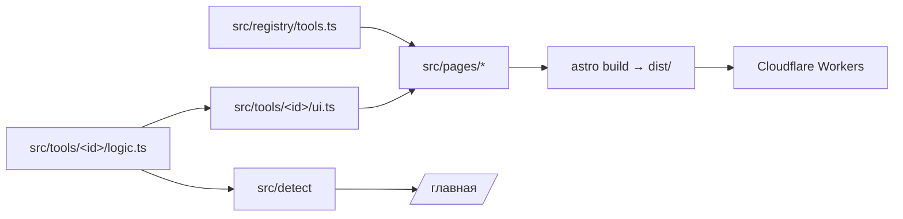

# Архитектура

Статический сайт: Astro собирает HTML каждого маршрута, интерактивность — небольшие скрипты на
ванильном TypeScript. Фреймворка в бандле нет, сервера нет. Хостинг — Cloudflare Workers со
статическими ассетами; Worker только раздаёт `dist/`.



## Структура `src/`

| Каталог           | Что внутри                                                                  |
| ----------------- | --------------------------------------------------------------------------- |
| `registry/`       | `tools.ts` — список инструментов. Единственный источник маршрутов и sitemap |
| `tools/<id>/`     | `logic.ts` — чистые функции (тестируются в node); `ui.ts` — работа с DOM    |
| `detect/`         | Автоопределение: лестница распознавателей поверх `logic.ts` инструментов    |
| `pages/`          | Маршруты Astro; страницы инструментов генерируются из реестра               |
| `layouts/`, `ui/` | Макет страницы и общие элементы (кнопка копирования, чипсы, статус)         |
| `styles/`         | Нативный CSS и токены дизайн-системы                                        |
| `egress/`         | Счётчик внешних запросов (`PerformanceObserver` по ресурсам)                |
| `worker/`         | Web Worker — только если замер покажет, что главный поток занят > 50 мс     |

Правила зависимостей: `registry` не импортирует `tools` и `ui`; `logic.ts` не трогает DOM;
новый инструмент — это каталог в `tools/` и запись в `registry/tools.ts`, всё остальное
(маршрут, sitemap, ссылки на главной) выводится из реестра.

## Запись `Tool`

```ts
interface Tool {
  id: string; // kebab-case, = сегмент маршрута; после релиза не меняется никогда
  name: string; // продуктовое имя, не переводится: «JWT Inspector»
  title: string; // <title> и H1 с поисковой формулировкой
  description: string; // meta description и вводный абзац (≤ 240 знаков)
  faq: { q: string; a: string }[]; // 3–5 пунктов
  sensitiveInput: boolean; // true → обнуление ввода при уходе со страницы (JWT)
}
```

Идентификаторы v1: `json`, `jwt`, `base64`, `url`, `unix-timestamp`, `uuid`.

## Страница инструмента

Без клиентского роутера: переход между инструментами — обычная навигация, поэтому состояние
ввода живёт в переменных модуля и умирает вместе со страницей. Для `sensitiveInput` дополнительно
на `pagehide` обнуляются поля ввода, ключ и буферы, переданные в WebCrypto (bfcache иначе
сохранит их).

Пользовательские данные попадают в DOM **только** через `textContent` и создание узлов.
`innerHTML`, `outerHTML`, `insertAdjacentHTML`, `srcdoc`, `document.write` запрещены линтом
(`.oxlintrc.json`); CSP `require-trusted-types-for 'script'` — второй рубеж в Chromium.

## Зависимости продукта

Своего кода хватает почти везде: `JSON.parse`, WebCrypto (HMAC-SHA256), `TextEncoder`,
`URL`/`URLSearchParams`, `Intl`. Для UUID v7/ULID допустимы `uuid` и `ulid` в чанке страницы
`/uuid`. Любая новая зависимость — запись в [decisions.md](decisions.md).

## Инварианты и их проверки

| Инвариант                                                          | Проверка                                        |
| ------------------------------------------------------------------ | ----------------------------------------------- |
| Ни одного запроса на сторонний origin; CSP `'self'`                | `tests/e2e/invariants.spec.ts`, `build.spec.ts` |
| Ввод не пишется в storage, cookie, IndexedDB, URL, history         | `tests/e2e/invariants.spec.ts`                  |
| Initial JS ≤ 40 KB gzip на страницу (статические импорты включены) | `tests/e2e/build.spec.ts`                       |
| Разметка из ввода не строится                                      | `pnpm lint`                                     |
| `Tool.id` не меняется после релиза                                 | правило в `CLAUDE.md`                           |

Инвариантные тесты обходят **все** страницы `dist/` и вводят маркер во все поля — новые
инструменты попадают под проверку автоматически.

## Заголовки

`public/_headers` — единственный источник: CSP (`default-src 'self'`, `script-src 'self'`,
`connect-src 'self'`, `frame-ancestors 'none'`, `require-trusted-types-for 'script'`), HSTS,
`Referrer-Policy: no-referrer`, COOP/CORP, кеш для хешированных ассетов. Cloudflare не
заменяет одноимённый заголовок, а дописывает, поэтому частные правила начинаются с
`! Cache-Control`.

## Сборка, тесты, деплой

- `pnpm check` — lint, Prettier, `tsc`, Vitest (node), сборка и Playwright.
- CI (`.github/workflows/ci.yml`) делает то же на каждый PR и push; push в `main` после
  зелёного прогона деплоит `wrangler deploy` и сверяет CSP прода.
- До релиза сайт закрыт от индексации (`noindex` в макете, `Disallow: /` в `robots.txt`).
